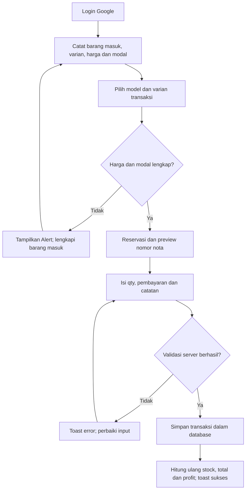
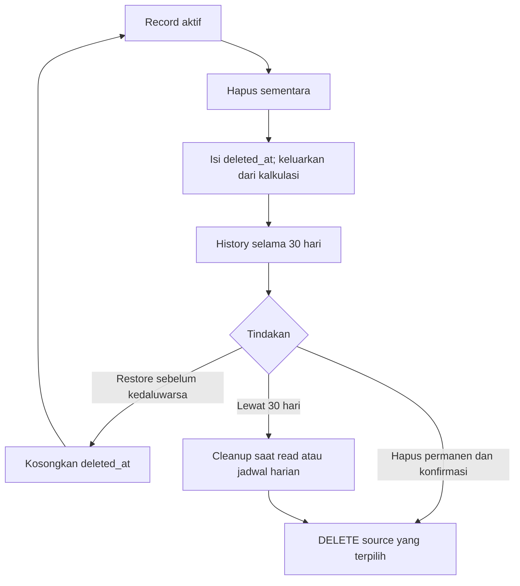
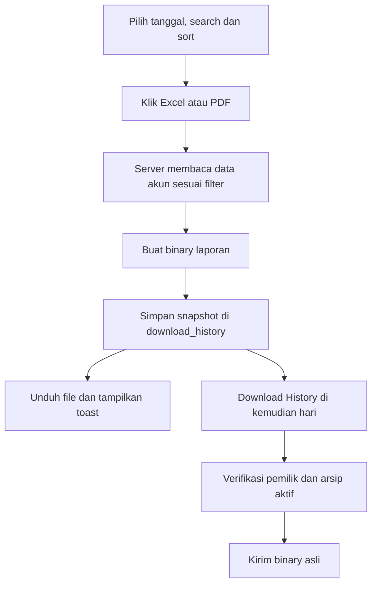

# Activity dan sequence

## Input barang dan penjualan



```mermaid
sequenceDiagram
  participant U as Pengguna
  participant UI as Form transaksi
  participant S as Server
  participant DB as PostgreSQL
  U->>UI: Pilih model dan varian
  UI->>S: previewInvoice
  S->>DB: Verifikasi katalog; increment counter atomik
  DB-->>S: Nomor berikutnya
  S-->>UI: Preview dan tanda tangan reservasi
  U->>UI: Simpan
  UI->>S: Input dan bukti reservasi
  S->>S: Verifikasi sesi, schema dan tanda tangan
  S->>DB: Harga terbaru; cek duplikat; INSERT dalam transaksi
  DB-->>S: COMMIT atau ROLLBACK
  S-->>UI: Hasil dan revalidasi
  UI-->>U: Toast; data terbarui
```

## Siklus History



Bulk mutation mengelompokkan ID berdasarkan sumber; server memakai daftar tabel tetap, scope pemilik dan transaksi database. Bila jumlah record yang terkena tidak sesuai pilihan, seluruh operasi rollback. Tidak ada recursive soft-delete atas item History.

## Ekspor dan arsip



Excel memiliki tabel transaksi berborder serta sheet Grafik dengan line/bar chart dan legenda. PDF memiliki tabel berborder. Mengubah transaksi berikutnya tidak mengubah arsip lama.

## Auth, waktu dan refresh

Login beralih ke Google; toast berhasil baru ditampilkan di callback tujuan ketika sesi tersedia. Logout menjalankan signOut lalu menuju login; toast berhasil membutuhkan sesi tidak aktif. Error autentikasi menuju login. Penanda feedback pada URL dibersihkan setelah diproses.

Zona waktu perangkat menentukan tanggal lokal dan tampilan timestamp. `sale_date`/`movement_date` adalah tanggal bisnis, sedangkan `created_at`/`deleted_at` adalah timestamp. Reload memakai skeleton pada area data, bukan menghapus workspace shell/sidebar. Toast refresh bersifat feedback pemuatan, bukan bukti audit database.
