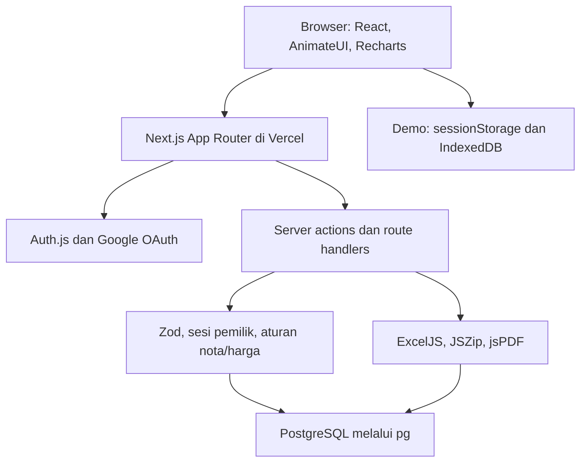

# Arsitektur dan kontrak aplikasi

## Komponen

| Lokasi | Tanggung jawab |
| --- | --- |
| `app/layout.tsx`, `workspace-shell.tsx` | Provider toast dan shell persisten; sidebar di luar loading route |
| `app/ui/dashboard.tsx` | Transaksi, detail/form, ringkasan dan ekspor |
| `app/ui/inventory.tsx` | Stock kumulatif, grouping/collapse dan pengelolaan catatan asal |
| `app/ui/paginated-table.tsx` | Pagination, scroll body, checkbox, floating actions |
| `app/ui/history-page.tsx` | Pencarian/filter dan restore History |
| `app/ui/downloads-page.tsx` | Metadata arsip dan unduh ulang |
| `app/ui/toaster.tsx` | Manager AnimateUI Base UI Toast, status auth dan feedback aktivitas |
| `lib/db.ts` | Query owner-scoped, transaksi SQL, schema guards dan cleanup |
| `lib/inventory.ts`, `transactions.ts`, `chart-data.ts` | Agregasi dan validasi domain |
| `lib/invoice*.ts` | Prefix, reservasi/format nota dan signature |
| `lib/export-bookkeeping.ts` | Penyusunan file dan arsip laporan |
| `lib/history.ts`, `downloads.ts` | Model History dan penyimpanan demo |

## Route

| Route | Fungsi |
| --- | --- |
| `/` | Dashboard akun: overview, inventory dan transactions melalui anchor |
| `/login` | Google sign-in dan pintu masuk demo |
| `/transaction-history` | History data terhapus milik akun |
| `/download-history` | Arsip unduhan akun |
| `/demo`, `/demo/transaction-history`, `/demo/download-history` | Padanan demo tanpa mutasi produksi |
| `/api/auth/[...nextauth]` | Handler Auth.js |
| `/api/images`, `/api/images/[id]` | Upload/baca gambar dengan sesi pemilik |
| `/api/downloads`, `/api/downloads/[id]` | Membuat arsip/mengunduh binary pemilik |
| `/api/cron/history-cleanup` | GET cleanup fixed cutoff 30 hari, tanpa parameter scope |

## Kontrak server actions

`mutateTransaction`, `mutateStock`, `removeTransaction`, `removeStock`, `previewInvoice`, `mutateTrash` memverifikasi sesi server. Input divalidasi Zod; ID harus UUID. Bulk maksimal 500 record. Mutasi mengembalikan hasil/error dan merevalidasi halaman terkait. `mutateTrash(input, restore, permanent)` memilih hapus sementara, restore, atau hapus permanen sumber yang sudah terhapus.

`removeHistory` merupakan action legacy yang tidak digunakan oleh UI saat ini. UI History menggunakan mutasi sumber, bukan menghapus log lama untuk berpura-pura memulihkan record.

## Aturan domain

- Stock per model/varian = jumlah incoming aktif sampai hari lokal − qty penjualan aktif sampai hari lokal.
- Sisa hari sebelumnya terbawa karena kalkulasi kumulatif, bukan proses pembuatan stock harian.
- Harga baru dipilih berdasarkan `created_at` input barang masuk terbaru, bukan tanggal pergerakan.
- Penjualan = qty × harga; modal = qty × cost; profit = penjualan − modal. Belum ada biaya operasional.
- Grup menyatukan nama produk trim/lowercase; varian tetap dapat dibedakan.
- Grafik memakai periode sendiri; filter tanggal/search tabel tidak otomatis membatasi chart.
- Stock kurang tidak memblokir penjualan; aplikasi memberikan peringatan rekonsiliasi.

## Keamanan dan batas sistem

Scope akun diterapkan pada query dan server actions. Demo tidak mengakses source produksi. Export dibuat ulang dari query akun di server, lalu disimpan sebagai snapshot; file/gambar memerlukan sesi pemilik. Secret hanya di environment hosting, tidak di repository.

Endpoint cleanup saat ini tidak memeriksa secret cron: ia hanya menjalankan cleanup idempotent dengan cutoff tetap, tanpa menerima owner/cutoff dari client dan tanpa mengembalikan data akun. Bila kebijakan operasional menuntut otorisasi scheduler khusus, verifikasi secret perlu ditambahkan sebagai pekerjaan terpisah; dokumentasi ini tidak mengklaim endpoint sudah memakai autentikasi cron.
