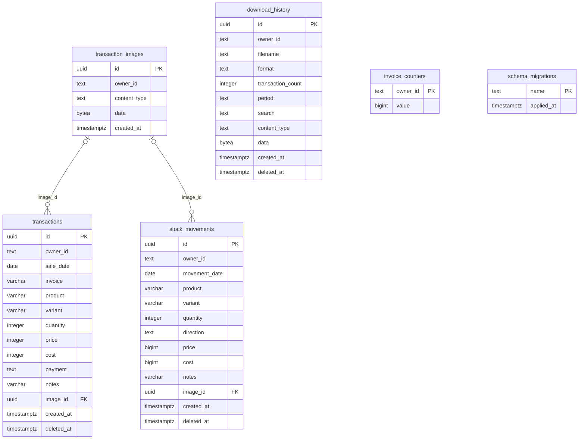

# Database dan ERD

Sumber kebenaran skema: [`migrations/`](../migrations/), [`lib/db.ts`](../lib/db.ts), [`lib/download-schema.ts`](../lib/download-schema.ts). Database PostgreSQL. Semua ID source berupa UUID; `owner_id` adalah identitas Google dari sesi, bukan foreign key ke tabel users lokal. Auth memakai JWT sehingga tidak ada tabel session/accounts/users aplikasi.

## Relasi fisik

Produk/varian bukan entitas master terpisah: katalog dan grouping diturunkan dari `stock_movements` aktif. Hubungan transaksi dengan produk adalah pencocokan nama/varian yang dinormalisasi, bukan `product_id` FK. Arsip ekspor adalah snapshot tanpa FK ke transaksi.

## Kamus data dan aturan

| Tabel | Data dan aturan |
| --- | --- |
| `transactions` | Qty 1–10000; harga/modal integer 0–1.000.000.000; produk ≤120, varian ≤80, nota ≤80, catatan ≤500 karakter. Payment: Tunai, Transfer bank, QRIS, E-wallet, Kartu. Harga adalah snapshot transaksi. |
| `stock_movements` | Qty 1–10000; skema legacy menerima in/out, tetapi form/server input saat ini hanya in. Price/cost bigint nullable untuk migrasi data lama; transaksi baru mensyaratkan lengkap. |
| `transaction_images` | JPG/PNG/WebP, `bytea` maksimal 3.145.728 byte. Gambar dimiliki akun; `stock_movements.image_id` menggunakan ON DELETE SET NULL. FK transaksi mengikuti perilaku default tanpa cascade. |
| `download_history` | File xlsx/pdf, jumlah transaksi, periode dan search, MIME, binary asli, waktu dibuat/dihapus. Ukuran file dihitung dari bytea saat read. |
| `invoice_counters` | Nama kolom `owner_id` historis; nilai key runtime berupa `invoice-v2:{owner}:{prefix}`. Counter bertambah atomik, maksimal 999 di query reservasi. Bukan FK akun. |
| `schema_migrations` | Nama file migrasi yang telah dijalankan beserta waktu. Runner memakai transaksi dan advisory lock. |
| `transaction_history` | Tabel audit legacy: id, owner_id, source_id, source, action, product, variant, quantity, direction, notes, invoice, occurred_at. Trigger dinonaktifkan migrasi 007; bukan sumber History sekarang. |

## Indeks dan konsistensi

- Indeks owner + tanggal pada transaksi/stock; owner + waktu pada download dan audit legacy.
- Indeks parsial `deleted_at IS NOT NULL` untuk cleanup sumber soft-delete.
- Nota dicek duplikat melalui query dan advisory lock per pemilik saat insert; bukan unique constraint gabungan di skema.
- Nomor reservasi terikat akun/model/varian melalui signature server. Pembatalan form tidak mengembalikan nomor counter.
- Source aktif berarti `deleted_at IS NULL`. Restore mengosongkan field ini; create time, nomor dan harga tidak dibuat ulang.
- Mutasi massal bersifat atomik; seluruh grup sumber rollback jika ada ID stale/tidak tersedia.

## Migrasi

| File | Perubahan |
| --- | --- |
| 001 | Transaksi dan indeks owner/tanggal |
| 002 | Counter nota, stock movements, gambar dan FK transaksi |
| 003 | Audit legacy, trigger, backfill satu kali |
| 004 | Arsip unduhan binary |
| 005 | Harga jual/modal barang masuk |
| 006 | Gambar barang masuk |
| 007 | Soft-delete pada tiga sumber, indeks retensi, menghentikan trigger audit |

Jalankan `npm run db:migrate` untuk baseline lengkap. Runtime juga memiliki schema guards idempotent untuk penambahan tertentu; guards bukan pengganti setup awal database kosong.

## Retensi dan keterbatasan

History saat ini UNION atas transaksi, stock, dan download yang dihapus. Data >30 hari dikeluarkan dari hasil dan dibersihkan saat History dibaca atau cron harian. Cleanup juga menghapus audit legacy kedaluwarsa. Download aktif tidak dihapus oleh retensi.

Referensi gambar dipertahankan selama soft-delete. Penghapusan permanen record tidak otomatis membersihkan semua blob gambar yatim; tidak ada garbage collector gambar pada implementasi sekarang. Kebijakan backup/provider database merupakan konfigurasi operasional terpisah dari aplikasi.
