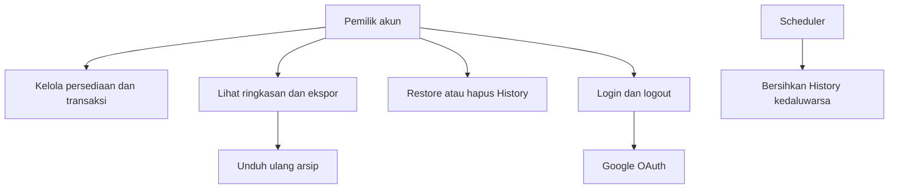

# Use case

## Aktor dan batas sistem

| Aktor | Peran |
| --- | --- |
| Pengunjung | Membuka login atau demo tanpa akses data akun |
| Pemilik akun Google | Mengelola data miliknya, laporan dan History |
| Google OAuth | Memverifikasi identitas dan memberikan profil dasar |
| Scheduler Vercel | Memanggil pembersihan tetap data kedaluwarsa |

## Skenario

| ID | Use case | Prasyarat | Alur utama | Hasil / alternatif |
| --- | --- | --- | --- | --- |
| UC01 | Login | OAuth terkonfigurasi | Klik Google → verifikasi Google → callback → dashboard | Sesi JWT dan profil; gagal/dibatalkan kembali login dengan feedback |
| UC02 | Catat barang masuk | Sesi valid | Isi tanggal, model, varian, qty, harga/modal; gambar/catatan opsional → simpan | Catatan aktif muncul, katalog dan stock dihitung ulang; input invalid ditolak |
| UC03 | Catat transaksi | Varian aktif dengan harga/modal | Pilih model/varian → reservasi preview nota → isi qty/pembayaran → simpan | Server memvalidasi pemilik, nota, harga; penjualan dan stock berubah |
| UC04 | Detail dan edit transaksi | Record aktif milik akun | Buka Detail atau Edit → ubah data → simpan | Data sumber diperbarui; nota tetap, transaksi historis mempertahankan harga yang tersimpan |
| UC05 | Kelola grup stock | Produk terlihat | Buka/lipat grup atau Edit grup → pilih catatan varian → edit/hapus | Agregat dihitung ulang; tidak ada record grup tersendiri |
| UC06 | Hapus sementara | Record aktif milik akun | Pilih checkbox/baris → hapus sementara | `deleted_at` terisi; hilang dari tabel aktif dan masuk History; gagal massal rollback |
| UC07 | Restore | Record di History <30 hari | Cari/filter jenis → pilih data → Restore | Identitas, harga, nota dan referensi gambar/file tetap; data kembali ke tabel asal |
| UC08 | Hapus permanen | Record sudah di History | Pilih data → Hapus permanen → konfirmasi | Source/file terpilih dihapus; tidak dapat restore; data aktif tidak boleh menjadi target |
| UC09 | Ekspor | Data/filter tersedia | Pilih Excel/PDF → server menentukan data pemilik → buat file dan simpan arsip | Download dimulai; gagal menampilkan error. Hasil kosong tetap dapat diekspor |
| UC10 | Unduh ulang | Arsip aktif pemilik | Download History → cari → Unduh kembali | Binary asli diunduh, tidak dibuat ulang dari transaksi terkini |
| UC11 | Cari/sort/pagination | Halaman tabel | Ketik search, klik header data, pilih 5/15/25/50 dan halaman | Hasil berubah; footer hilang bila kosong; pilihan massal disesuaikan konteks |
| UC12 | Grafik dan ringkasan | Data aktif | Pilih periode chart atau tanggal tabel | Chart mengikuti periodenya sendiri; ringkasan mengikuti transaksi terfilter |
| UC13 | Logout | Sesi aktif | Klik Keluar → server signOut → login | Sesi berakhir; toast sukses setelah redirect |
| UC14 | Cleanup | Data telah lewat 30 hari | Scheduler atau pembacaan History memicu cleanup | Hapus permanen hanya sumber kedaluwarsa; arsip aktif tetap |

## Aturan lintas use case

- Identitas pemilik berasal dari sesi server, bukan parameter akun dari client.
- Data demo terisolasi di penyimpanan browser. Upload gambar demo tidak tersedia.
- Feedback toast menampilkan proses/hasil/error; field validation tetap dapat muncul dalam form.
- Tidak ada use case admin lintas akun, transfer stok antar akun, pembayaran online, atau penghitungan pajak pada rilis ini.
